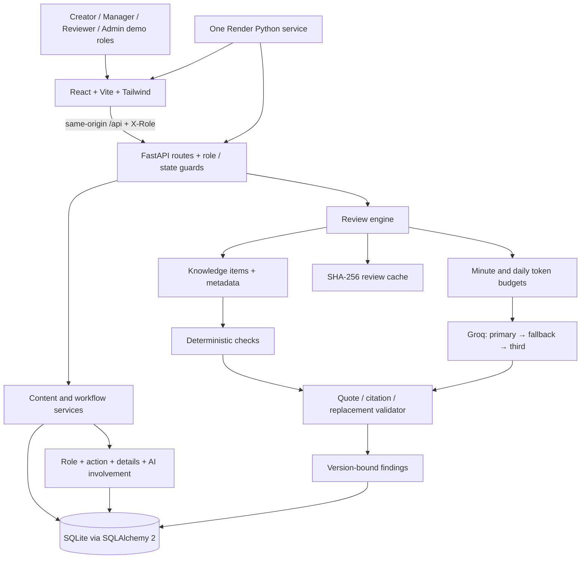

# Architecture

Submission re-verification exercised the public API workflow, UI labels and uncached Groq token accounting on 22 October 2026. [Verification methods](submission/VERIFICATION.md) separate live observations from implementation inspection and mocked tests.

## Deployed shape

FastAPI serves committed Vite assets from `backend/app/static` and returns `index.html` for frontend deep links. Unknown `/api` routes return JSON 404, not the SPA. Render uses the root requirements file and Uvicorn start command in `render.yaml`.

## Data and workflow

`KnowledgeItem` stores code, kind, text, metadata and optional expiry. `Content` stores channel and workflow state. `ContentVersion` keeps text, sequential version number, source, creator role and review timestamp. Findings bind to a specific version and include exact offsets, source codes, decisions and override reasons. Comments and audit events bind to content. `ReviewCache` stores serialized review results and `AIUsage` stores observed response token usage.

Creator edits are permitted only in Draft or Changes requested. Applying accepted/edited findings replaces exact slices from right to left and creates a version. The latest version must be reviewed before submission; every high finding must be decided, and accepted/edited fixes must be applied first. A Manager sends retained Reviewer-required findings to Pending reviewer; a Reviewer records a reason to approve. Return records a comment and requests changes. Every state-changing API operation writes an audit event. The shared demo reset intentionally clears previous content/audit history, records its own reset event, and preserves the local AI usage table.

## Review and grounding

Rules are driven by KB metadata: patterns, regex, disclosure, hashtag count, hype, expired offers, conflicting years and prices. Pattern matching respects the metadata's case sensitivity and sensible word boundaries. Expiry checks use IST.

One logical AI analysis uses the complete compact KB, channel, draft and compact rule findings. Provider retries/fallbacks can make multiple HTTP requests. Draft delimiters are escaped inside the untrusted payload. Requests use JSON output, low temperature, 2,500 maximum completion tokens, and low reasoning effort for GPT-OSS. A 400 retries once without the effort parameter. Short Retry-After values are honoured once; other failures fall through the configured model chain and eventually return rules-only findings.

The validator drops unmatched quotes and maps normalized whitespace/case back to exact draft slices. Unknown KB codes become null and unverified; these findings have no acceptable replacement and low severity, or medium for unsupported factual claims. Terminology pattern policies are authoritative: AI cannot invent additional banned variants. Replacements are checked against content rules as local phrases using the social channel; whole-draft influencer disclosure is checked on mandatory re-review. Overlap merging keeps the more severe finding (rule wins a tie), preserves additional citations and Reviewer risk, and invalidates replacements when the highlighted span expands.

Code existence and literal quote grounding do not establish semantic entailment. The UI therefore says **Verified citation**, while unsupported findings explicitly need a human.

## Reliability decisions

- Cache key: normalized whitespace in text + channel + KB hash + use-AI flag, SHA-256. Cached results are re-grounded to current offsets. Transient AI failures are not cached.
- Precomputed responses load only when the full KB hash matches. The UI identifies the model and precomputation time.
- Minute usage is in-memory per model; daily token usage is a UTC-day database sum. Models are skipped at 6,400 minute tokens or 180,000 daily tokens, or while a request is in flight. Provider account-wide quotas and exact future request token costs are not known locally.
- A 10-review/minute per-IP limiter, 5,000-character draft limit, friendly validation errors and provider-failure handling protect the demo experience.
- SQLite and in-memory controls are designed for one process/instance. The default deployment uses one Uvicorn process; this is not a distributed limiter.
- No auth, vector database, background queue or separate frontend deployment was added for the MVP. These choices reduced deployment dependencies while keeping human workflow, citations, versions and audit visible.

Verified behavior and its scope are recorded in [BUILD_VERIFICATION.md](BUILD_VERIFICATION.md). Production limitations are listed in [KNOWN_ISSUES.md](KNOWN_ISSUES.md).
